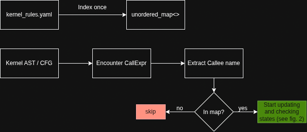
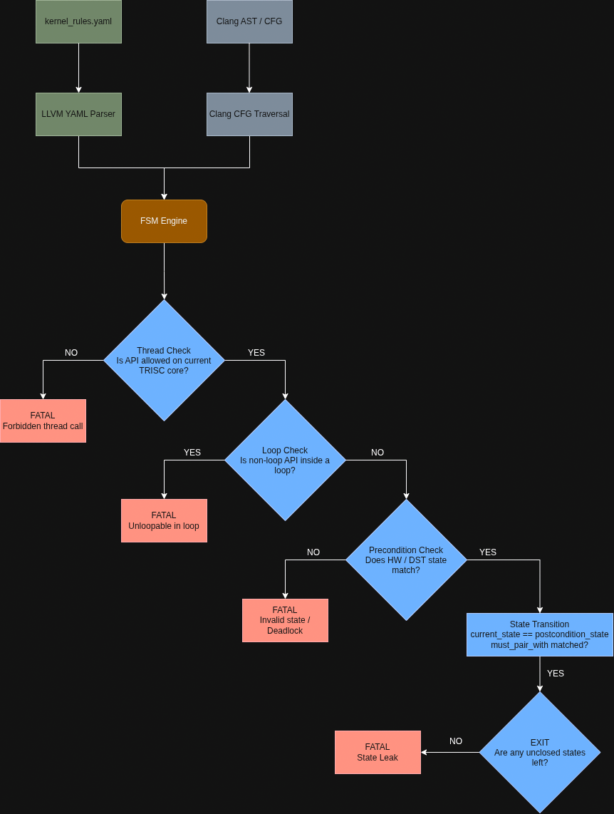

# Tensix Kernel API Specification

This document describes the structure of `specs/api_spec.yaml`

______________________________________________________________________

## Overview

The formal specification in `specs/api_spec.yaml` serves as the **single source of ground truth** for:

1. Low-level Tensix compute (`TRISC0/1/2`) and data movement (`BRISC/NCRISC`) API contracts.
2. Hardware register state machines and double-buffering lockstep invariants.
3. Permitted caller thread contexts, loop nest restrictions, and mandatory pairing rules (`acquire`/`commit`, `init`/`uninit`).
4. Known failure modes, hardware hangs, and memory corruption scenarios caused by API misuses.

______________________________________________________________________

## Structure of the YAML Specification

The document is organized into four top-level sections:

```yaml
version: '1.0'
description: '...'
architectures: ['Wormhole_B0', 'Blackhole', 'Quasar']
threads: [...]
states: [...]
instructions: [...]
```

### `threads` Section

Defines the distinct execution processors on each Tensix core:

- **`TRISC0_UNPACK`**: Feeds input tiles from L1 circular buffers into `SrcA` and `SrcB` register banks.
- **`TRISC1_MATH`**: FPU/SFPU matrix multiplication, element-wise math, and vector ops writing into destination registers (`DST`).
- **`TRISC2_PACK`**: Reads computed data from `DST`, formats/quantizes, and packs into output circular buffers in L1.
- **`DM_BRISC`** & **`DM_NCRISC`**: Primary and secondary RISC processors driving asynchronous Network-on-Chip (NoC) transfers and circular buffer semaphores.

### `states` Section (*can be changed*)

Catalog of all discrete hardware, register, and synchronization states:

- **`UNINITIALIZED`**: Pre-startup state prior to `compute_kernel_hw_startup`.
- **`CANONICAL_IDLE`**: Baseline 32x32 tile mode with standard strides and zero edge masks.
- **`MATH_IDLE`** / **`MATH_DST_HELD`**: Math thread destination register lockstep double-buffering states.
- **`PACK_IDLE`** / **`PACK_DST_HELD`**: Pack thread destination register wait/release states.
- **`IN_TILIZE_MODE`**, **`IN_UNTILIZE_MODE`**, **`IN_REDUCE_MODE`**, **`IN_UNARY_BCAST_MODE`**, **`IN_CUSTOM_MM_DENSE_MODE`**: Specialized hardware operational modes.

### `instructions` Section (*some fields might be removed*)

An array of 98 detailed API specifications. Each record contains:

| Field                  | Type           | Description                                                                                                                                                                       |
| :--------------------- | :------------- | :-------------------------------------------------------------------------------------------------------------------------------------------------------------------------------- |
| **`name`**             | `string`       | Unqualified C++ function identifier matching the AST callee (e.g. `matmul_tiles`, `tile_regs_acquire`).                                                                           |
| **`signature`**        | `string`       | Full C++ signature including template parameters and default arguments.                                                                                                           |
| **`header`**           | `string`       | Relative path to defining header file in `tt-metal`.                                                                                                                              |
| **`category`**         | `string`       | Functional group (`startup`, `reg_lifecycle`, `cb_lifecycle`, `dataflow_noc`, `reconfig`, `matmul`, `reduce`, `tilize`, etc.).                                                    |
| **`thread_affinity`**  | `list[string]` | Threads permitted to execute this instruction (`TRISC0_UNPACK`, `TRISC1_MATH`, `TRISC2_PACK`, `DM_BRISC`, `DM_NCRISC`).                                                           |
| **`placement`**        | `string`       | Syntactic/structural placement rule (`entry_block_only`, `between_acquire_commit`, `between_wait_release`, etc.).                                                                 |
| **`allowed_in_loop`**  | `boolean`      | `false` if the instruction performs slow MMIO or breaks loop pipelining (e.g., `compute_kernel_hw_startup`).                                                                      |
| **`state_machine`**    | `object`       | • `precondition_state`: State required prior to call.<br>• `postcondition_state`: State resulting after execution.<br>• `must_pair_with`: Paired API required to close the state. |
| **`parameters`**       | `list[object]` | Parameter names, types, `is_template` flags, and semantic roles.                                                                                                                  |
| **`hardware_effects`** | `list[string]` | Concrete hardware registers, MOP engines, or semaphores updated.                                                                                                                  |
| **`failure_mode`**     | `string`       | Exact failure, deadlock, or data corruption that occurs if violated.                                                                                                              |
| **`description`**      | `string`       | Summary of the instruction's purpose.                                                                                                                                             |

*TODO*: add an `error_message` field that will display an error and provide possible fix (like try to add mul_uninit()); may be paired with `hardware_effects` field.

______________________________________________________________________

## how i see the hypothetical pipeline

**one-time rule indexing** followed by **path-sensitive AST and CFG traversal**.

### phase 1



______________________________________________________________________

### phase 2


