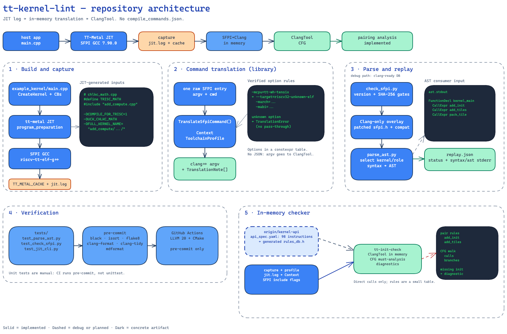

# Repository overview

This document describes the repository on `dev/ast_normalization` after the
merge with `main`.

## What the repository is

`tt-kernel-lint` is a Clang-based checker for Tenstorrent kernels. It finds
kernel operations that have no matching initialization.

The repository contains three implemented pieces:

1. A C++ library that captures a JIT compiler command, builds a real SFPI
   profile, and translates the GCC command into a Clang command.
2. An in-memory checker that passes the translated command directly to
   `ClangTool`, builds the CFG, and reports operations with missing
   initializers.
3. A Python pipeline that validates the SFPI SDK and can replay a captured
   kernel through Clang for AST inspection.

No intermediate `compile_commands.json` is required by the checker. The JIT log
is read, translated, and parsed in one process.



Diagram source: [repository-architecture.excalidraw](repository-architecture.excalidraw).

## Repository map

| Path                                            | Role                                                                      |
| ----------------------------------------------- | ------------------------------------------------------------------------- |
| `CMakeLists.txt`                                | Builds the frontend library, analysis library, and checker.               |
| `tt_kernel_lint/include/ttkl/`                  | Public interfaces: context, profile, capture, translator, checker.        |
| `tt_kernel_lint/src/ttkl/capture.cpp`           | Parses `g++ compile cmd:` lines into `Context` objects.                   |
| `tt_kernel_lint/src/ttkl/sfpi_profile.cpp`      | Derives target mapping and SFPI include paths from the captured compiler. |
| `tt_kernel_lint/src/ttkl/translator.cpp`        | SFPI GCC to Clang command translation.                                    |
| `tt_kernel_lint/src/ttkl/check/`                | CFG collection and init/operation pairing analysis.                       |
| `tt_kernel_lint/tools/tt-init-check/main.cpp`   | Runs capture, translation, `ClangTool`, and reporting in one process.     |
| `tt_kernel_lint/src/ttkl/sfpi_option_rules.hpp` | Internal tables of kept, dropped, and replaced command options.           |
| `scripts/check_sfpi.py`                         | Verifies the SFPI 7.90.0 installation and creates a Clang-only overlay.   |
| `scripts/parse_ast.py`                          | Debug path: selects a captured kernel context and dumps the AST.          |
| `scripts/compat/`                               | Pinned SFPI manifest and Clang compatibility header.                      |
| `example_kernel/main.cpp`                       | Host TT-Metal program that creates and runs three kernels.                |
| `example_kernel/device/`                        | Reader, writer, and compute kernel sources.                               |
| `tests/`                                        | Unit tests for the Python tools and launcher scripts.                     |
| `docs/jit-clang-ast-replay.md`                  | Step-by-step capture and AST replay guide.                                |
| `jit_example.sh`                                | Builds the example and performs JIT preparation with or without a device. |
| `run_example_kernel.sh`                         | Builds the example and executes it on device 0.                           |
| `setup.sh`                                      | Creates the Python environment, installs hooks, and runs all hooks.       |
| `tt-metal/`                                     | Git submodule for TT-Metal.                                               |

## Build system

`CMakeLists.txt` requires CMake 4.0 and C++20. It finds LLVM and Clang through
`find_package` and builds three targets:

```text
tt_kernel_lint_frontend   static library: capture, profile, translator
tt_kernel_lint_analysis   static library: CFG collection and pairing analysis
tt-init-check             executable: in-memory JIT log to Clang pipeline
```

`tt_kernel_lint_frontend` links `LLVMSupport`. The analysis library and checker
link `clang-cpp` and `LLVM`.

`BUILD_KERNELS=OFF` is the default. With `BUILD_KERNELS=ON`, CMake adds the
`tt-metal` subdirectory, builds `example_kernel`, links `TT::Metalium`, and
defines `EXAMPLE_KERNEL_SOURCE_DIR`.

## Component 1: C++ command translator

The public API is:

```cpp
llvm::Expected<TranslationResult> TranslateSfpiCommand(
    const Context& context, const ToolchainProfile& profile);
```

The function consumes one raw SFPI invocation. It does not read
`compile_commands.json`, select a kernel, or create `Context` or
`ToolchainProfile`. `tt-init-check` creates those values from the JIT log and
calls the translator directly.

`ReadCaptureLog` parses `g++ compile cmd:` lines, recovers `KernelId` and
`CompileCommand`, and filters by kernel and TRISC role. `MakeSfpiProfile`
derives the CPU mapping and SFPI include paths from the captured compiler.

Input types:

- `CompileCommand`: `directory`, `source_file`, `arguments`.
- `KernelId`: kernel `name`, JIT configuration `variant`, and `ThreadRole`
  (`kUnpack`, `kMath`, or `kPack`).
- `Context`: immutable pair of `KernelId` and `CompileCommand`.
- `CpuMapping`: `mcpu`, `triple`, `march`, `mabi`.
- `ToolchainProfile`: profile `name`, `sfpi_ver`, `cpus`, and
  `system_include_directories`.

`Context` is one compile invocation plus its kernel identity, and the caller
builds it. In `compile_commands.json`, `directory`, `file`, and `arguments`
supply `CompileCommand`; the kernel name, variant, and role must be recovered
from the `-D` macros (`FULL_KERNEL_NAME`, `UCK_CHLKC_*`, `COMPILE_FOR_TRISC`)
as `parse_ast.py` does for replay.

`ToolchainProfile` describes the verified SFPI release and CPU mapping. It is
a caller-supplied value, not LLVM's target profile, and `main` has no loader or
predefined instance.

Output types:

- `TranslationResult`: translated `CompileCommand` and a list of
  `TranslationNote` records (`kAdded`, `kRemoved`, `kReplaced`).
  `TranslationResult::command.arguments` starts with `clang++`; it is the Clang
  compilation command translated from the SFPI GCC command.
- `TranslationError` with kind `kMalformedCommand`, `kUnsupportedCompiler`,
  `kUnsupportedCpu`, or `kUnsupportedOption`.

Translation rules:

- The compiler basename must be `riscv-tt-elf-g++`. It becomes `clang++`.
- `-mcpu=<name>` must match a `CpuMapping`. It becomes `--target=`, `-march=`,
  and `-mabi=`.
- `-std=c++17` is kept unless a `-ftt-*` C++20 backport is present. Then it
  becomes `-std=c++20`.
- Dependency, code-generation, dump, and LTO options are removed with a
  recorded reason.
- Include, define, undefine, and warning options are kept.
- Any other option is an error. The translator never passes an unknown option
  through.
- Exactly one source file and one `-mcpu=` option are required.

`ToolchainProfile::system_include_directories` is declared but not read by the
translator.

## Component 2: SFPI verification and overlay

`scripts/check_sfpi.py` protects the assumption that the SFPI SDK is the pinned
release. It performs these checks:

1. Read `tt-metal/tt_metal/sfpi-version`.
2. Compare manifest keys with `scripts/compat/sfpi-7.90.0.json`.
3. Run `riscv-tt-elf-g++ --version` and require the pinned version and build in
   the banner.
4. Compute SHA-256 for every file under `include/` and require an exact match
   with the specification.
5. Select `tt-metal/runtime/sfpi` before `/opt/tenstorrent/sfpi`.

With `--output-dir`, the script copies the verified include tree to a new
directory and applies one semantic patch:

```diff
-sfpi_inline vInt (impl_::vMag);
+sfpi_inline explicit vInt (impl_::vMag);
```

It also copies `sfpi_clang_compat.hpp`, which declares `__xtt_vector8` for
Clang, and writes `manifest.json`. The script rejects an existing destination
and leaves the installed SDK unchanged.

## Component 3: AST replay

`scripts/parse_ast.py` consumes a compilation database and selects exactly one
context. Selection requires all of these properties:

- Main file name is `trisck.cc`.
- `KERNEL_BUILD` is defined.
- `FULL_KERNEL_NAME` matches the requested kernel or `NAME/VARIANT`.
- Exactly one `UCK_CHLKC_<ROLE>` macro is defined.
- `COMPILE_FOR_TRISC` equals `0`, `1`, or `2` for unpack, math, or pack.
- `FW_BUILD` is not defined.
- The working directory ends with `kernels/<identity>/trisc<role>`.
- The generated wrapper `chlkc_<role>.cpp` defines `TRISC_<ROLE>` and includes
  exactly one source file for the kernel.

The replay then performs these steps:

1. Remove output and dependency options from the command.
2. Replace the SFPI public include directory with the overlay when requested.
3. Optionally force-include the compatibility header.
4. Run `clang++ -fsyntax-only`.
5. If syntax succeeds, run the same command with `-ast-dump` and an AST filter.
6. Write `replay.json`, `syntax.*`, `ast.*`, and `*.command.json`.

Exit codes are `0` for success, `1` for a compiler failure, and `2` for invalid
input.

## Component 4: Example kernel

`example_kernel/main.cpp` builds one mesh workload that adds two 32x32 bfloat16
tiles:

- `reader.cpp`: reads two tiles from DRAM into circular buffers 0 and 1.
- `add_compute.cpp`: runs `compute_kernel_hw_startup`, `add_init`, `add_tiles`,
  and `pack_tile` on the math thread.
- `writer.cpp`: writes circular buffer 16 to DRAM.

The program supports three modes:

- No argument: execute on device 0 and check results.
- `--jit-without-device`: JIT compile with a mock Wormhole configuration.
- `--jit-with-device`: open device 0 and JIT compile with its configuration.

`jit_example.sh` selects the JIT mode and enables compiler command logging.
`run_example_kernel.sh` executes the kernel and rejects JIT flags.

## Component 5: Tests and CI

Three `unittest` modules cover the Python tools and launcher routing:

- `tests/test_parse_ast.py`: context selection, argument filtering, overlay
  replacement, CLI errors, and stale output removal.
- `tests/test_check_sfpi.py`: version gates, header hashes, exact patching, and
  local SDK precedence.
- `tests/test_jit_cli.py`: launcher mode routing with stub executables.

There are no unit tests for the C++ translator.

The suite assumes Linux path semantics. On macOS, three `test_parse_ast`
assertions fail because `Path.resolve()` maps `/var` to `/private/var`.

The GitHub Actions workflow installs LLVM 20, configures CMake, and runs
`pre-commit`. The hooks include `black`, `isort`, `flake8`, `cmake-format`,
`mdformat`, `clang-format`, and `clang-tidy`. The workflow does not run
`unittest`.

Additional tooling:

- `setup.sh` creates `.venv`, installs `requirements-dev.txt`, installs the
  hooks, and runs them on all files.
- `.clang-tidy` enables a broad check set with documented exclusions.
- `docs/jit-clang-ast-replay.md` records the manual capture and replay
  procedure, including the SFPI Clang incompatibilities.

## Component 6: In-memory checker

`tt-init-check` is the production path:

```bash
tt-init-check --input-log CAPTURE/jit.log \
  --kernel add_compute --role math
```

For each selected context it:

1. Parses the raw SFPI command.
2. Builds a `ToolchainProfile` from the captured compiler path and `-mcpu`.
3. Calls `TranslateSfpiCommand`.
4. Wraps the translated command in an in-memory `CompilationDatabase`.
5. Runs `ClangTool` on that single command.
6. Matches `kernel_main`, builds its CFG, and applies the pairing analysis.

The analysis uses must-dataflow: an initializer counts only if it reaches the
operation on every incoming CFG path. The current rule table covers direct
calls for the common eltwise, matmul, copy, and block operations.

`tt-init-check` uses `llvm::cl` for its command line. The available options
are `--input-log`, `--kernel`, and `--role`; `--help` and `--version` are
provided by LLVM.

Exit status is `0` when no findings exist, `1` when a finding or analysis error
exists, and `2` for invalid command-line usage.

## End-to-end data flow

The production path stays in memory:

```text
example_kernel/main.cpp
  -> TT-Metal JIT build
  -> SFPI GCC invocation per TRISC role
  -> jit.log ("g++ compile cmd: ...")
  -> ReadCaptureLog
  -> Context + MakeSfpiProfile
  -> TranslateSfpiCommand
  -> in-memory CompilationDatabase
  -> ClangTool -> MatchFinder -> kernel_main
  -> CFG -> init/operation pairing -> findings
```

The Python replay path remains available for debugging:

```text
jit.log
  -> tt-metal build_kernel_clang_tidy_commands.py
  -> Clang-ready compile_commands.json
  -> parse_ast.py
  -> syntax check + AST dump
```

`compile_commands.json` is no longer part of the checker path. It can still be
generated for `parse_ast.py` or for inspecting translated commands.

## What is missing

The checker is implemented, but these parts are still incomplete:

- Pairing rules are a small hardcoded table. The `api_spec.yaml` data on
  `origin/kernel-api` is not integrated.
- Only direct `CallExpr` calls are analyzed. Wrapper functions and function
  pointers are not followed.
- The rule table does not yet cover every TT-Metal operation.
- A committed negative test kernel with a missing initialization is absent.
- C++ tests for the capture parser, translator, and analysis core are absent.
- A captured example run and a full end-to-end test on Linux CI are absent.
- `tt-metal` is initialized, but SFPI is not installed in this environment.

## Related branches

These branches contain checker-related work. `dev/ast_normalization` is now
merged into the current branch and its prototype has been replaced by
`tt-init-check`.

| Branch                         | Contents                                                                                                                                                            | State                                                       |
| ------------------------------ | ------------------------------------------------------------------------------------------------------------------------------------------------------------------- | ----------------------------------------------------------- |
| `origin/kernel-api`            | `specs/api_spec.yaml` with 98 instruction records, `scripts/generate_rules_db.py`, generated `ttkl/kernel_api/{common,rule,rules_db}.h`, and a specification guide. | Rule data and generator; not integrated with the checker.   |
| `origin/dev/ast_normalization` | Historical prototype. The original `clang-tidy` directory matched `kernel_main`, built its CFG, and collected direct calls.                                         | Merged; superseded by `tt_kernel_lint/tools/tt-init-check`. |
| `origin/wip/ast-parse`         | Historical branch with the same tree content as `main`.                                                                                                             | Superseded.                                                 |

## Quick commands

The launcher scripts target Linux and expect Clang and LLVM 20 under
`/usr/lib/llvm-20`. Adjust the paths on other systems.

```bash
# Configure and build the frontend, analysis library, and checker
cmake -S . -B build -G Ninja \
  -DLLVM_DIR=/usr/lib/llvm-20/lib/cmake/llvm \
  -DClang_DIR=/usr/lib/llvm-20/lib/cmake/clang
cmake --build build

# Create the Python environment
./setup.sh

# Verify SFPI and create a Clang overlay
python3 scripts/check_sfpi.py --output-dir /path/to/sfpi-clang

# Run the in-memory checker
./build/tt-init-check \
  --input-log /path/to/capture/jit.log \
  --kernel add_compute \
  --role math

# Debug path: dump the AST
python3 scripts/parse_ast.py \
  --capture /path/to/capture \
  --kernel add_compute \
  --role math \
  --compat-header /path/to/sfpi-clang/sfpi_clang_compat.hpp \
  --sfpi-overlay /path/to/sfpi-clang/include \
  --ast-filter kernel_main

# Run the Python tests
python3 -m unittest discover -s tests
```
