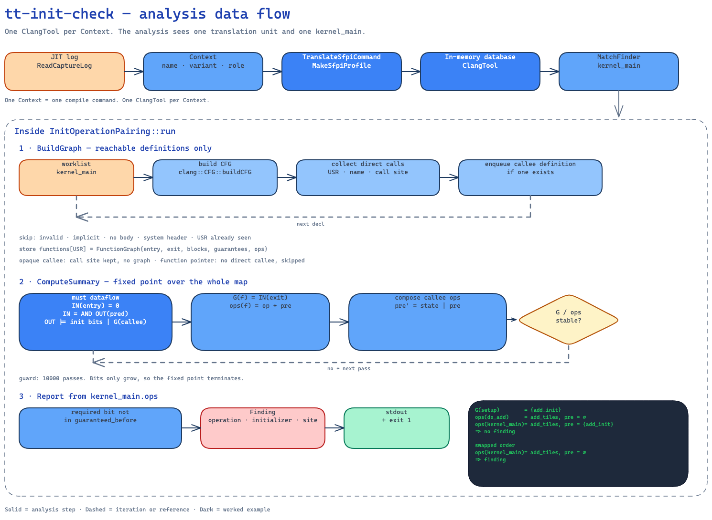
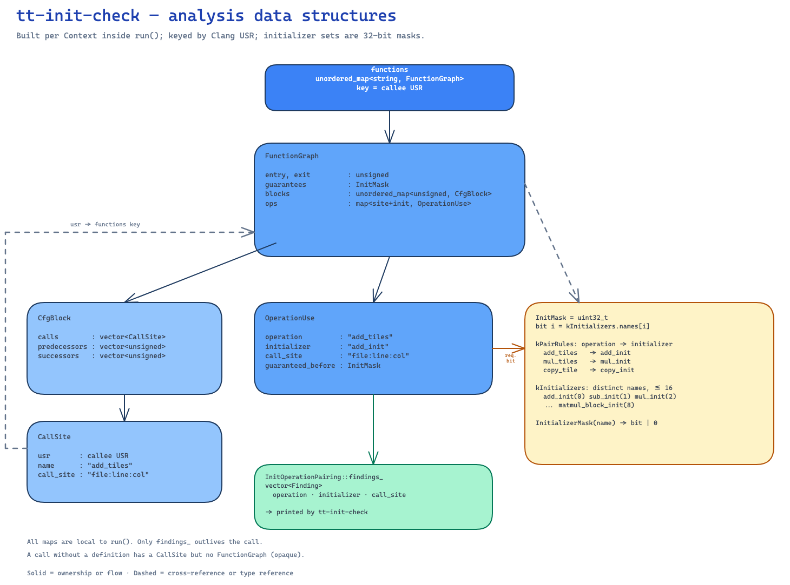

# Kernel analysis: graph building and matching

This document describes the analysis inside `tt-init-check`. It explains how
the tool builds a call graph from `kernel_main` and how it decides that an
operation has no matching initializer.

Data flow:



Data structures:



## Scope

`InitOperationPairing::run` is called once per `Context`, after `ClangTool`
parses one translated command. A `Context` is one captured SFPI compile
command: one kernel, one JIT variant, one TRISC role. The analysis therefore
sees one translation unit and one `kernel_main`.

The analysis starts at `kernel_main` and follows direct calls into every
function definition reachable inside that translation unit. This includes
helper functions defined in headers. It does not follow function pointers and
does not follow calls whose callee has no definition in the unit.

## Graph building

`BuildGraph` walks a worklist of `clang::FunctionDecl` pointers. The worklist
starts with the matched `kernel_main`:

1. Pop a declaration.
2. Skip it if it is invalid, implicit, has no body, or is a non-root definition
   in a system header.
3. Compute its USR. Skip it if the USR is already in the map.
4. Build a CFG with `clang::CFG::buildCFG`.
5. For each CFG block, record the direct calls. A call contributes the callee
   USR, the callee's unqualified name, and the call site.
6. If the callee has a definition, push it onto the worklist.
7. Record predecessor and successor block IDs, then store the function graph
   under its USR.
8. Repeat until the worklist is empty.

Two details make the result a graph rather than a list of functions:

- A function is processed once, keyed by USR. Recursion and repeated calls do
  not duplicate it.
- The map is built from reachability, not from every declaration in the
  translation unit. Uncalled inline functions do not enter the graph.

Calls to functions without a definition remain as call sites. They have no
function graph and are treated as opaque during matching.

## Matching

Matching uses a fixed rule table (`kPairRules`). Each row maps an operation name
to the initializer name it requires:

```text
add_tiles   -> add_init
mul_tiles   -> mul_init
copy_tile   -> copy_init
add_block   -> add_init
...
```

The distinct initializer names form `kInitializers`. Each name has a bit index,
and `InitializerMask(name)` returns a `uint32_t` with that bit set. Unknown
names return zero. This makes sets of initializers cheap to intersect and
union.

For every function graph, `ComputeSummary` produces:

- `guarantees`: the initializers that run on every path through the function.
- `ops`: every operation call reachable in the function, with the
  initializers guaranteed before it.

### Must dataflow

The summary uses a must analysis over the CFG. A block's input is the
intersection of its predecessors' outputs, so an initializer counts only if it
is present on every incoming path.

- The entry block starts with an empty set. The function body is analyzed as if
  no initializer ran before the call.
- A known initializer call adds its bit to the running set.
- A call to a function with a graph adds that function's `guarantees`.
- `guarantees` of the function itself is the input set of the CFG exit block.

The analysis repeats over all functions because a callee's guarantees can grow
as its own callees are summarized. Starting from empty sets, the fixed point
terminates because bits are only added and the set of initializers is finite.

### Operation composition

After the dataflow, the function is walked again in block order. The running
set is the block input, updated by each call:

- An initializer call sets its bit.
- An operation call whose name is in `kPairRules` records
  `(operation, required initializer, call site, current set)`.
- A call to a function with a graph composes that callee's operations:
  `pre = current set | callee_pre`. The callee's `guarantees` are then added to
  the running set for the rest of the block.

Composed operations are deduplicated by call site and initializer. If the same
operation is reachable through several call sites, their guaranteed sets are
intersected. That keeps the result a must guarantee: one path without the
initializer is enough to report.

### Reporting

`AnalyzeGraph` reads the operation list of `kernel_main`. It reports a finding
when the required initializer's bit is absent from the operation's guaranteed
set. The finding records the operation, the initializer, and the operation's
source location.

## Worked example

```cpp
inline void setup() { add_init(0, 1); }       // init_helper.hpp
inline void do_add() { add_tiles(0, 1, 0, 0, 0); }  // op_helper.hpp

void kernel_main() {
    setup();
    do_add();
}
```

The graph contains `kernel_main`, `setup`, and `do_add`, keyed by USR.

- `guarantees(setup)` is `{add_init}`.
- `ops(do_add)` contains `add_tiles` with an empty guaranteed set.
- In `kernel_main`, the call to `setup` adds `{add_init}`.
- The call to `do_add` composes `add_tiles` with `{add_init}`.
- The required bit is present, so no finding is reported.

If the two calls are swapped, the composed set for `add_tiles` is empty and a
finding is emitted.

A conditional case behaves the same way. If only one branch calls `setup`, the
intersection at the join drops `add_init`, and the operation is reported.

## Data structures

| Type            | Contents                                                     |
| --------------- | ------------------------------------------------------------ |
| `FunctionGraph` | `entry`, `exit`, `guarantees`, `blocks`, `ops`               |
| `CfgBlock`      | `calls`, `predecessors`, `successors`                        |
| `CallSite`      | callee `usr`, unqualified `name`, `call_site`                |
| `OperationUse`  | `operation`, `initializer`, `call_site`, `guaranteed_before` |
| `InitMask`      | `uint32_t` bit set over `kInitializers`                      |
| `Finding`       | `operation`, `initializer`, `call_site`                      |

`FunctionGraph` values live in an `unordered_map` keyed by USR.
`OperationUse` values live in a `map` keyed by call site and initializer, so
output order is deterministic. `blocks` is keyed by CFG block ID.

All analysis data is local to `InitOperationPairing::run`. Only the
`std::vector<Finding>` survives the call.

## Limits

- Function pointers are not resolved, so a call through a pointer is invisible.
- A callee without a definition is opaque. If it calls an initializer, the
  analysis cannot see it and may report a false positive.
- A helper defined in a system header is not traversed. Calls to it remain
  visible, but any initializer inside it is not modeled.
- Rules are name-based. Overloads with the same unqualified name are treated
  alike.
- The fixed-point loop is capped at 10000 passes. Current kernel graphs
  converge in a few passes.
