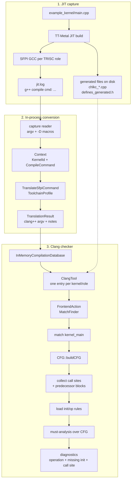

# In-memory kernel checker plan

Status: implemented on `dev/ast_normalization`. This file is kept as the
pre-implementation design record.

## Goal

Integrate the `kernel_main` CFG prototype with the SFPI GCC to Clang converter
without creating an intermediate `compile_commands.json`.

The production pipeline is:

```text
JIT log -> Context -> TranslateSfpiCommand -> in-memory Clang command
        -> ClangTool -> MatchFinder -> CFG -> pairing analysis -> findings
```

`compile_commands.json` is only an optional debug artifact.

## Current state before implementation

`clang-tidy/init_operation_pairing/LLKInitModule.cpp` is a standalone Clang
tool, not a clang-tidy check.

It:

1. Uses `CommonOptionsParser` to read a compilation database.
2. Runs `ClangTool` with a `MatchFinder`.
3. Matches every `kernel_main` definition.
4. Builds a CFG.
5. Records direct calls, USRs, locations, and predecessor block IDs.
6. Prints only the source paths.

It does not:

- Emit findings.
- Apply init/operation pairing rules.
- Walk the CFG for path-sensitive state.
- Isolate multiple kernels or roles.
- Reuse the converter.

The header is empty. The directory name is misleading: a real clang-tidy check
is a plugin derived from `ClangTidyCheck`, not an executable with `main`.

## Structure decision

Keep the checker standalone. Do not convert it to a clang-tidy plugin yet.

Recommended layout:

```text
tt_kernel_lint/
  include/ttkl/
    compilation_ctx.hpp
    target_profile.hpp
    capture.hpp
    sfpi_profile.hpp
    translator.hpp
    check/init_operation_pairing.hpp
  src/ttkl/
    capture.cpp
    sfpi_profile.cpp
    translator.cpp
    check/init_operation_pairing.cpp
  tools/
    tt-init-check/main.cpp
```

A clang-tidy plugin can be added later around the same analysis core.

## Phase 1: Capture parsing

Add a capture reader that turns TT-Metal JIT log lines into `Context` objects.

Input line:

```text
g++ compile cmd: <full SFPI GCC argv> (build.cpp:NNN)
```

Steps:

01. Strip ANSI SGR sequences.
02. Find the `g++ compile cmd:` marker.
03. Remove the `(build.cpp:NNN)` suffix.
04. Split the command into argv.
05. Rejoin `-D` values whose template arguments were split on spaces.
06. Require `KERNEL_BUILD`; skip `FW_BUILD`.
07. Read `COMPILE_FOR_TRISC` to select unpack, math, or pack.
08. Read `FULL_KERNEL_NAME` to build `KernelId`.
09. Derive `directory` from the `-o` operand.
10. Select the `.cc` or `.cpp` source file.
11. Filter by requested kernel and role.

No file is written.

## Phase 2: Toolchain profile

Add `MakeSfpiProfile(compiler, mcpu)`.

It supplies:

- The `-mcpu` to triple, `-march`, and `-mabi` mapping.
- SFPI newlib and libstdc++ include directories.
- `-nostdinc++` and `-nostdlibinc`.
- The `int32_t` type-model overrides for `ilp32`.
- Warning suppressions for GCC/Clang divergence.

The existing `ToolchainProfile` needs an extra `clang_flags` field for flags
that are not present in the captured GCC command.

## Phase 3: In-memory Clang command

Do not write `compile_commands.json`.

`TranslationResult::command` already matches Clang tooling:

| `CompileCommand` | Clang tooling                 |
| ---------------- | ----------------------------- |
| `directory`      | `CompileCommand::Directory`   |
| `source_file`    | `CompileCommand::Filename`    |
| `arguments`      | `CompileCommand::CommandLine` |

Use a small database adapter:

```cpp
class InMemoryCompilationDatabase final
    : public clang::tooling::CompilationDatabase {
public:
    explicit InMemoryCompilationDatabase(
        std::vector<clang::tooling::CompileCommand> commands)
        : commands_(std::move(commands)) {}

    std::vector<clang::tooling::CompileCommand>
    getCompileCommands(llvm::StringRef) const override {
        return commands_;
    }

    std::vector<std::string> getAllFiles() const override {
        std::vector<std::string> files;
        for (const auto& command : commands_) {
            files.push_back(command.Filename);
        }
        return files;
    }

    std::vector<clang::tooling::CompileCommand>
    getAllCompileCommands() const override {
        return commands_;
    }

private:
    std::vector<clang::tooling::CompileCommand> commands_;
};
```

Run one command at a time:

```cpp
auto translated = TranslateSfpiCommand(context, profile);
if (!translated) {
    llvm::errs() << translated.takeError();
    return 1;
}

clang::tooling::CompileCommand command{
    translated->command.directory,
    translated->command.source_file,
    translated->command.arguments,
    /*Output=*/""};

InMemoryCompilationDatabase database({command});
clang::tooling::ClangTool tool(database, {command.Filename});
```

`ClangTool` uses `CompileCommand::Directory` as the working directory. A
separate `setWorkingDirectory` call is not required.

One `ClangTool` invocation per `Context` removes the `trisck.cc` ambiguity:
each invocation represents one kernel, variant, and role.

## Phase 4: Analysis core

Extract the matcher and CFG code from `main`.

Public data:

```cpp
namespace tt::lint {

struct CallSite {
    std::string usr;
    std::string name;
    std::string definition_site;
    std::string call_site;
};

struct CfgBlock {
    unsigned id{};
    std::vector<CallSite> calls;
    std::vector<unsigned> predecessors;
};

struct Finding {
    std::string operation;
    std::string initializer;
    std::string call_site;
};

class InitOperationPairing final
    : public clang::ast_matchers::MatchFinder::MatchCallback {
public:
    void run(const clang::ast_matchers::MatchFinder::MatchResult&) override;
    const std::unordered_map<unsigned, CfgBlock>& blocks() const;
    const std::vector<Finding>& findings() const;
};

}  // namespace tt::lint
```

Rules:

- `add_tiles` -> `add_init`
- `sub_tiles` -> `sub_init`
- `mul_tiles` -> `mul_init`
- `matmul_tiles` -> `matmul_init`
- `copy_tile` -> `copy_init`
- reuse-dest variants -> matching reuse-dest init
- block variants -> matching init

## Phase 5: Pairing analysis

Use must-analysis over the CFG.

For every block:

```text
in[b]  = intersection(out[p]) for every predecessor p
out[b] = in[b] union initializers called in b
```

For every block, walk calls in order:

1. If the call is an initializer, add it to the state.
2. If the call is an operation with a rule, require its initializer in the
   state.
3. If the initializer is absent, emit a finding with the call site.

The initial state for the entry block is empty.

Start with direct calls only. Wrapper functions and function pointers are a
later extension.

## Phase 6: Command-line tool

`tt-init-check`:

```text
tt-init-check --input-log CAPTURE/jit.log
             --kernel add_compute
             --role math
```

Internally:

1. Read and filter capture entries.
2. For each entry, find `-mcpu`.
3. Build the SFPI profile.
4. Translate the command.
5. Build an in-memory database.
6. Run `ClangTool`.
7. Print findings.
8. Return nonzero on findings or errors.

Suggested exit codes:

- `0`: no findings
- `1`: finding or analysis error
- `2`: invalid command line

## Dataflow diagram



The only file-system dependency left is the generated JIT content: Clang still
reads the wrappers and headers from the JIT cache. There is no database file.

## Acceptance criteria

1. A synthetic JIT log produces a Clang AST without a compile database.
2. The good `add_compute` example produces no findings.
3. Removing `add_init` produces one finding at the `add_tiles` call site.
4. An initializer on only one branch produces one finding.
5. An initializer before the operation produces no finding.
6. Existing Python tests continue to pass.
7. The project builds with `-Wall -Wextra -Werror`.

## Open risks

- GCC/Clang header parity, especially SFPI newlib and libstdc++ paths.
- PCH flags captured from the JIT command.
- CFG path sensitivity for loops.
- Rules currently cover only a subset of TT-Metal operations.
- Direct-call analysis misses wrappers and function pointers.
